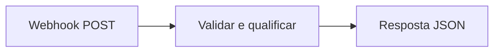

# Automação de leads com n8n

Workflow para receber leads por webhook, validar os dados e classificar o nível de interesse a partir da mensagem enviada.

## Fluxo

1. O webhook recebe uma requisição `POST`.
2. O nó de código limpa e valida nome, e-mail e campos opcionais.
3. A mensagem recebe uma classificação de interesse: baixo, médio ou alto.
4. O webhook devolve uma resposta JSON com o lead organizado.

O fluxo não usa serviços pagos nem credenciais externas.



## Tecnologias

- n8n 2.6.4
- JavaScript no Code node
- Docker Compose
- Webhook HTTP e JSON

## Executar com Docker

Importe o workflow:

```bash
docker compose run --rm n8n import:workflow --input=/workflows/captura-leads.json
```

Inicie o n8n:

```bash
docker compose up -d
```

Acesse `http://localhost:5678`, conclua o cadastro local, abra o workflow **Captura e qualificação de leads** e publique o fluxo.

## Testar o webhook

PowerShell:

```powershell
$body = Get-Content -Raw .\examples\lead.json
Invoke-RestMethod `
  -Method Post `
  -Uri http://localhost:5678/webhook/captura-leads `
  -ContentType 'application/json' `
  -Body $body
```

Resposta esperada:

```json
{
  "sucesso": true,
  "statusCode": 201,
  "lead": {
    "nome": "Carlos Alberto",
    "email": "carlos@example.com",
    "interesse": "alto"
  }
}
```

## Testes automatizados

O teste verifica a estrutura do workflow e executa o mesmo código usado pelo nó de validação:

```bash
node tests/test-workflow.mjs
```

## Próximas melhorias

- Registrar os leads em uma planilha ou banco de dados.
- Enviar uma notificação por WhatsApp ou e-mail.
- Adicionar autenticação e limite de requisições ao webhook.

## Autor

Carlos Alberto Gomes Junior

## Agente nutri pelo WhatsApp

A pasta [`agente-nutri/`](agente-nutri/README.md) tem um agente que cria e mantém
o site e o app Android de uma nutricionista a partir de pedidos pelo WhatsApp
(Evolution API + n8n + Claude Code). Veja o guia de instalação no README da pasta.
