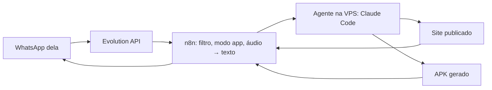

# Flavinha: agente da nutricionista Odete pelo WhatsApp

A nutricionista Odete pede mudanças pelo WhatsApp à **Flavinha** ("adiciona uma receita sem glúten",
"muda as cores para lilás") e um agente de código (Claude Code ou Codex) altera
o site, publica e devolve o app Android (APK) na conversa.



## O que tem aqui

| Pasta/arquivo | Função |
| --- | --- |
| `template/` | App inicial (PWA de nutrição: receitas com filtros, verificador de rótulos, diário). É copiado uma vez para o volume de dados. |
| `template/AGENTS.md` | Regras que o agente segue (tom das respostas, cuidados com conteúdo de saúde, LGPD). |
| `builder/server.mjs` | Recebe os pedidos do n8n, roda o agente, faz commit de cada mudança, publica o site e serve o APK. |
| `builder/build-apk.sh` | Empacota o site como APK com Capacitor. |
| `../workflows/agente-nutri-whatsapp.json` | Workflow do n8n (Evolution API). |

## Como ela usa

1. Manda **`#app`** para você. A partir daí, durante 30 minutos, tudo o que ela mandar (texto ou áudio) vai para o agente.
2. Pede o que quiser, do jeito dela. Recebe "Recebi! ✍️…" e, alguns minutos depois, a resposta com o link do site e o APK atualizado.
3. Comandos rápidos: **`link`**, **`desfazer`** (volta a última mudança), **`apk`** (gera o app de novo), **`sair`** (volta à conversa normal).

Fora do modo app, as mensagens dela são ignoradas pelo agente. Assim a conversa
pessoal de vocês não aciona nada e áudios pessoais não são transcritos.

## Instalação na VPS

### 1. Token do Claude (no seu computador)

```bash
claude setup-token
```

Copie o token gerado (vale por cerca de 1 ano). Os pedidos dela usam o mesmo
limite do seu plano; `LIMITE_DIARIO` no `.env` evita que o agente esgote tudo.

### 2. Configurar e subir o agente

Pelo terminal da VPS (na Hostinger: hPanel → VPS → **Terminal do navegador**):

```bash
git clone -b claude/admiring-knuth-i2mbvl https://github.com/calbertogomesjr-oss/automacao-leads-n8n.git
```

```bash
cd automacao-leads-n8n/agente-nutri && bash instalar.sh
```

O `instalar.sh` pergunta o domínio, o token do Claude, o identificador e o nome
do app, gera o `.env`, sobe o container e mostra o valor da credencial para o n8n.

Se preferir fazer à mão:

```bash
cp .env.example .env
```

Preencha o `.env`:

- `TOKEN`: senha longa (gere com `openssl rand -hex 32`). O n8n usa a mesma.
- `URL_PUBLICA`: domínio onde o site vai ficar, ex. `https://nutri.stfu.fun`.
- `CLAUDE_CODE_OAUTH_TOKEN`: o token do passo 1.

**Antes de subir pela primeira vez**, ajuste em `template/capacitor.config.json`:

- `appId`: identificador único do app (ex. `br.com.anasilva.nutri`). **Não dá para trocar depois** sem quebrar as atualizações.
- `appName`: nome que aparece no celular (ela pode mudar depois pelo WhatsApp).

```bash
docker compose up -d --build
```

O primeiro build baixa o Android SDK e demora alguns minutos. Acompanhe:

```bash
docker logs -f agente-nutri
```

### 3. Domínio (HTTPS pelo Traefik da VPS)

O `docker-compose.yml` já traz as *labels* para o Traefik que roda na VPS
(provider docker, `exposedbydefault=false`, entrypoint `websecure`, certresolver
`letsencrypt`). Nada muda no container do Traefik: ele detecta o container novo
sozinho.

1. Crie um registro DNS **A** do `DOMINIO` apontando para o IP da VPS.
2. Espere o DNS propagar. O certificado do Let's Encrypt (desafio HTTP) só sai depois disso.
3. Teste:

```bash
curl -s https://nutri.stfu.fun/saude
```

A rota `/tarefa` exige o `TOKEN`; o resto (site e `/app.apk`) é público.

### 4. Workflow no n8n

1. Importe `workflows/agente-nutri-whatsapp.json`.
2. No nó **Configuração**, preencha:
   - `numerosPermitidos`: número dela com DDI e DDD (ex. `5547999998888`). Para testar, adicione outro número seu separado por vírgula; mensagens enviadas pelo próprio número conectado são ignoradas.
   - `evolutionUrl` e `instancia`: os mesmos que você já usa.
   - `agenteUrl`: a `URL_PUBLICA` do agente. Se o n8n estiver na mesma rede Docker, pode usar `http://agente-nutri:3100`.
   - `prefixo` (`#app`) e `minutosModoApp` (`30`): ajuste se quiser.
3. Credenciais:
   - Nós **Avisar que começou**, **Responder**, **Enviar APK** e **Baixar áudio**: selecione a credencial *Header Auth* da Evolution que você já tem (`apikey`).
   - Nó **Executar agente**: crie uma *Header Auth* com nome `Authorization` e valor `Bearer SEU_TOKEN`.
   - Nó **Transcrever (OpenAI)**: selecione sua credencial da OpenAI.
4. **Ative** o workflow (o modo app guarda estado só em execuções de produção).

### 5. Webhook da Evolution

> A Evolution precisa estar saudável (`docker ps` sem "Restarting"). Sem ela,
> o n8n não recebe as mensagens do WhatsApp e o agente não é acionado.

Cada instância da Evolution manda os eventos para **uma** URL. Escolha:

- **Instância já aponta para outro workflow seu** (mais comum): nesse workflow,
  logo depois do webhook, adicione um IF "remetente é ela?" e, no ramo verdadeiro,
  um *HTTP Request* que faz `POST` do corpo recebido (JSON: `{{ JSON.stringify($json.body) }}`) para
  `https://SEU_N8N/webhook/agente-nutri`. Faça o ramo dela não seguir para o seu
  bot atual, para os dois não responderem juntos.
- **Instância sem webhook**: configure a URL `https://SEU_N8N/webhook/agente-nutri`
  com o evento `MESSAGES_UPSERT`.

## Instalar o app no celular dela

- **Android**: tocar no `Nutri.apk` recebido e permitir "instalar apps desconhecidos"
  para o WhatsApp. Atualizações instalam por cima, mantendo os dados.
- **iPhone**: abrir o link do site no Safari → Compartilhar → "Adicionar à Tela de Início".
- **Play Store** (opcional, depois): exige conta de desenvolvedor Google e um APK/AAB
  assinado com chave de release.

O APK é assinado com a chave guardada no volume `android`. **Não apague esse
volume**: com outra chave, o Android recusa a atualização e ela teria que
desinstalar o app (perdendo o diário).

## Trocar de agente

No `.env`:

- **Claude com API key** (cobrança por uso): troque `CLAUDE_CODE_OAUTH_TOKEN` por `ANTHROPIC_API_KEY`.
- **Codex/OpenAI**: `AGENTE=codex` e `OPENAI_API_KEY=...`.

Depois rode `docker compose up -d`.

## Segurança e cuidados

- O agente roda com permissões totais **dentro do container** (sem acesso às suas
  outras automações). Só o número dela, no modo app, chega até ele.
- Cada pedido vira um commit no volume `dados`, então dá para voltar qualquer versão.
- O `AGENTS.md` proíbe inventar afirmações clínicas, mantém o aviso "não substitui
  consulta" e guarda os dados do diário só no aparelho (LGPD).

## Testes

```bash
node tests/test-agente-nutri.mjs
```

Os testes cobrem o filtro de mensagens do workflow (modo app, grupos, nono dígito,
`@lid`), o verificador de rótulos e o servidor com um agente falso (publicação,
APK, histórico, desfazer, falhas e limite diário).
